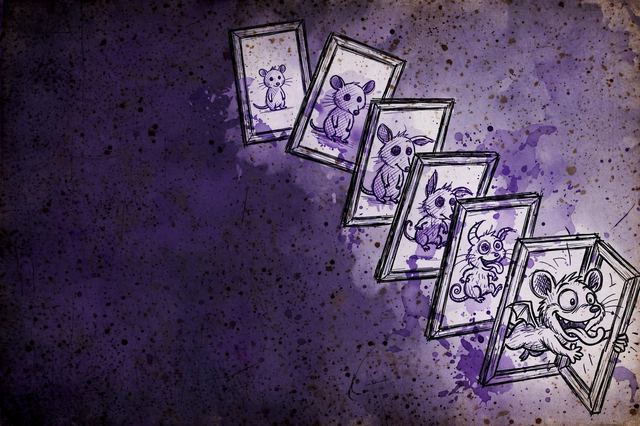
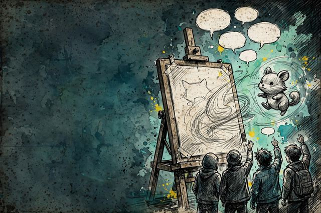
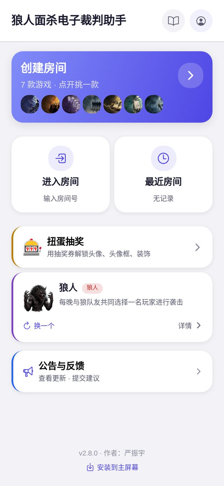
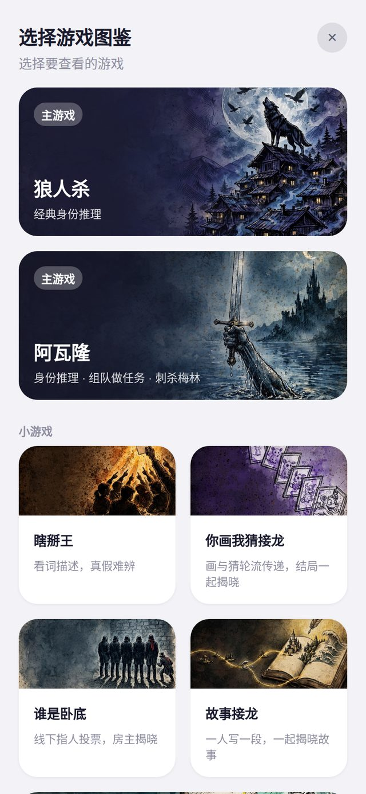
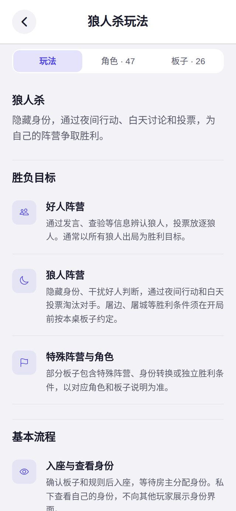
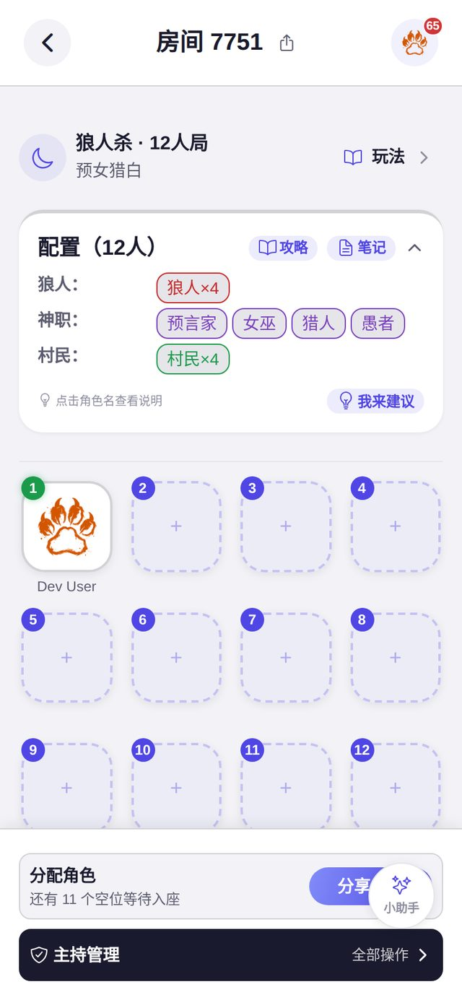
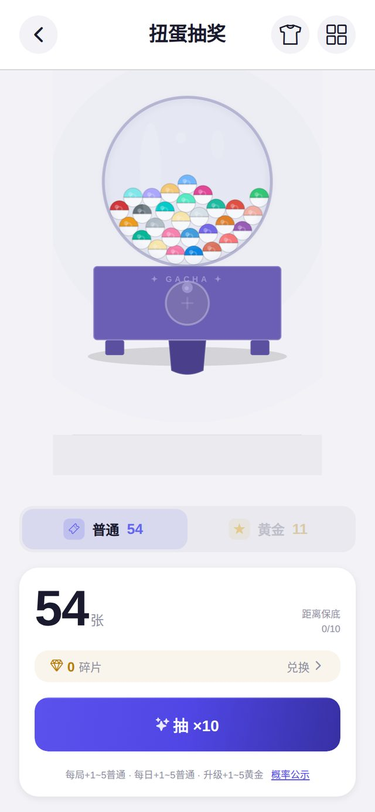

<div align="center">

# 🐺 狼人杀电子法官

**不用法官的线下聚会游戏平台**

7 个游戏 · 一间房 · 一个 4 位房间码，全桌一起玩

[](https://werewolfgamer.com)
[](https://github.com/olveryu/WerewolfGameJudge/actions/workflows/ci.yml)
[](LICENSE)
[](https://github.com/olveryu/WerewolfGameJudge/stargazers)

[English](./README.en.md) · [隐私说明](PRIVACY.md) · [更新日志](CHANGELOG.md)


</div>

---

## ⚡ 30 秒上手

1. **房主**打开 [werewolfgamer.com](https://werewolfgamer.com)，选游戏、创建房间
2. 把 **4 位房间码**发给同桌的朋友
3. 朋友输码入座、查看自己的身份/词卡，房主点开始——剩下的交给法官

主要玩法在微信小程序（搜「狼人面杀电子裁判助手」）：微信登录，打开即玩。网页版免登录可看首页与图鉴，创建房间需先登录（邮箱或匿名访客一键进入），也可添加到手机主屏幕像 App 一样用；iOS / Android App 同样可用。

---

## 🎮 游戏一览

<table>
  <tr>
    <td width="50%">
      
      <br><b>🐺 狼人杀</b> · 按板子定（预设 12 人）
      <br>首夜全自动法官：身份确认、技能行动、天亮结算全程语音引导，白天发言投票由玩家自行进行
    </td>
    <td width="50%">
      
      <br><b>🏰 阿瓦隆</b> · 5–10 人
      <br>好坏两阵营轮流组队出任务：好人先赢下 3 个任务获胜，坏人靠破坏任务、连续否决或终局刺杀梅林翻盘
    </td>
  </tr>
  <tr>
    <td>
      
      <br><b>🤥 瞎掰王</b> · 4–20 人
      <br>每轮一个冷门词：老实人知道真实释义，瞎掰王现场编，大聪明听完所有人的描述后，由房主代其逐个点选座位辨真假
    </td>
    <td>
      
      <br><b>🕵️ 谁是卧底</b> · 4–12 人（白板需 6 人起）
      <br>多数人拿到同一个词，卧底拿一个相关但不同的词、白板没词；线下描述讨论，房主揭示出局者，系统自动判定胜负
    </td>
  </tr>
  <tr>
    <td>
      
      <br><b>🎨 你画我猜接龙</b> · 4–20 人
      <br>每人写题后在「看文字作画」和「看画猜词」之间交替接龙，最后逐条回放整本画册
    </td>
    <td>
      
      <br><b>✏️ 经典你画我猜</b> · 4–12 人
      <br>轮流一人作画、其余人在聊天里打字猜词，猜中按速度计分，画手按猜中人数得分，每人画 2 轮后按总分排名
    </td>
  </tr>
  <tr>
    <td>
      
      <br><b>📖 故事接龙</b> · 4–20 人
      <br>每人开一篇故事，后续每棒只能看到上一段续写，全部写完后逐篇揭晓全文；没有胜负，纯看一桌人能编多离谱
    </td>
    <td>
      <br><b>…以及同一间房</b>
      <br>所有游戏共用同一套房间、座位、断线重连与对局记录。换游戏不用换 App，不用重新拉人。
    </td>
  </tr>
</table>

---

## 📱 界面一览

<table>
  <tr>
    <td align="center"><br><sub>首页 · 创建 / 进入房间</sub></td>
    <td align="center"><br><sub>游戏库 · 7 款游戏</sub></td>
    <td align="center"><br><sub>狼人杀图鉴 · 47 角色 / 26 板子</sub></td>
    <td align="center"><br><sub>房间大厅 · 入座等开局</sub></td>
    <td align="center"><br><sub>扭蛋机 · 抽券解锁装扮</sub></td>
  </tr>
</table>

---

## 🙅 为什么不用真人法官

线下玩这类游戏，总要有人当主持——而主持的人不能玩：

- 🙅 法官/主持只能旁观，一局都参与不了
- 📖 新手主持容易记混流程、漏判胜负
- 🔇 口述推进效率低，身份和阶段一多就出错

这个 App 把主持工作全部接管：发身份、推阶段、判胜负、播语音。**所有人，包括房主，都是玩家。**

---

## ✨ 平台特性

|                            |                                                                                                                                                          |
| -------------------------- | -------------------------------------------------------------------------------------------------------------------------------------------------------- |
| 📱 **多设备实时同步**      | 4 位房间码加入，WebSocket 实时推送游戏状态，操作秒级同步                                                                                                 |
| 🔌 **断线自动恢复**        | 游戏状态持久化在 Cloudflare Durable Objects（边缘 SQLite），重连自动恢复到最新状态                                                                       |
| 🎰 **扭蛋收集 · 等级成长** | 每局得 XP 与抽奖券，扭蛋收集头像、头像框、座位装饰、名字样式、身份揭示特效、座位动画共 **1043 件**，5 级稀有度（Common → Mythic）+ 10 次保底；等级无上限 |
| 🌐 **跨平台**              | iOS · Android · Web · 微信小程序四端，同一间房                                                                                                           |

---

## 🐺 狼人杀专区（招牌游戏）

- 🔊 **首夜全自动语音**：身份确认、技能行动、天亮公告全程播报，房主也能闭眼参与；配 BGM 与音效
- 🎭 **47 种角色 · 26 套预设板子**：神职、特殊狼人、第三方一应俱全，预设均为 12 人局，另支持自定义板子——[角色技能对照表](docs/NIGHT1_ROLE_ALIGNMENT_MATRIX.md) · [预设板子参考](docs/PRESET_BOARDS.md)
- 🤖 **AI 规则助手**：点角色卡上的 AI 气泡，随时问技能细节与策略（Gemini 3.5 Flash Lite，Worker 代理）
- ☀️ 白天发言、投票、放逐由玩家同桌进行——App 只管首夜，那是狼人杀最需要法官的部分

---

## 🏗 架构

```
┌─────────────────────────────────────────────────┐
│          Cloudflare Worker（游戏逻辑权威）         │
│  ┌──────────┐  ┌───────────┐  ┌──────────────┐  │
│  │ REST API │  │ game-engine│  │ Durable Object│  │
│  │ (Auth +  │  │ (纯逻辑)  │  │  (GameRoom)  │  │
│  │  Game)   │  │           │  │  WebSocket   │  │
│  └────┬─────┘  └─────┬─────┘  └──────┬───────┘  │
│       └──────────────┴───────────────┘           │
│            Cloudflare D1 · R2                     │
└─────────────────────┬───────────────────────────┘
        iOS · Android · Web · 微信小程序（web-view）
           HTTP 提交 · WebSocket 接收 · Host 播音频
```

三层结构：**平台层**共用房间、座位、连接、重连与广播管线；**游戏层**每个游戏有独立状态机与规则（`packages/game-engine/src/games/<game>/` 与 `src/games/<game>/`）；**目录层**在引擎、Worker、客户端各只有一个穷尽式 catalog，漏注册会在编译期或契约测试中失败。

核心约束：服务端是唯一游戏逻辑权威，客户端不做逻辑决策；所有客户端平等，Host 只是 UI 与音频角色；`GameState` 是单一真相源，服务端读-算-写-广播。

技术栈：React Native 0.85 · Expo SDK 56 · TypeScript 6 · Cloudflare Workers / D1 / R2 / Durable Objects · Jest · Playwright · Sentry

---

## 🛠 开发

```bash
pnpm install          # 安装依赖
pnpm run dev          # Worker + Expo Web 同时启动 (localhost:8787 + :8081)
pnpm run quality      # 完整质量门禁（类型、构建、Knip、lint、格式、测试）
pnpm run e2e          # Playwright E2E

# 本地 D1 seed — dev 用户 (dev@test.local / dev123) + 全物品解锁
pnpm -F @game-judge/api-worker db:migrate:local
pnpm -F @game-judge/api-worker db:seed:local
```

贡献者与 AI 编码助手请先读 [AGENTS.md](AGENTS.md)（构建、测试与代码约定）；新游戏可用 `pnpm run new-game` 从生成器脚手架起步，接入清单见多游戏平台设计文档。

---

## 📚 文档

- [多游戏平台设计](docs/multigame-platform-design.md) · [房间壳契约](docs/room-shell-contract.md)
- 各游戏设计：[阿瓦隆](docs/avalon-game-design.md) · [瞎掰王供词](docs/fibking-word-supply.md) · [谁是卧底](docs/undercover-game-design.md) · [你画我猜接龙](docs/pictionary-game-design.md) · [经典你画我猜](docs/drawguess-game-design.md) · [故事接龙](docs/story-relay-game-design.md)
- [部署指南](docs/DEPLOYMENT.md) · [设计系统](docs/DESIGN.md) · [网络韧性设计](docs/network-resilience-design.md)
- [扭蛋系统](docs/gacha-system-design.md) · [等级成长](docs/growth-system-design.md) · [线下玩法 SOP](docs/offline-sop.md)

---

## ❓ 常见问题

<details>
<summary><b>需要注册账号吗？</b></summary>

微信小程序内用微信登录，无需单独注册。网页版浏览首页与图鉴不用登录；创建房间需先登录，支持邮箱账号或匿名访客一键进入——需要保存自定义板子等数据时建议用邮箱账号。

</details>

<details>
<summary><b>每个游戏都自动主持吗？</b></summary>

是的。7 个游戏都由服务端主持阶段推进、判定与结算，共用同一套房间与断线恢复；需要同桌口头进行的环节（卧底的描述、狼人杀的白天发言）由玩家线下进行，App 给出阶段提示。

</details>

<details>
<summary><b>游戏数据存储在哪里？</b></summary>

游戏状态在 Cloudflare Durable Objects（边缘 SQLite），房间元数据在 D1，房间创建满 24 小时后自动清理。AI、错误监控、邮件与反馈等外部服务处理的数据、用途与保留规则见[隐私说明](PRIVACY.md)。

</details>

<details>
<summary><b>可以自定义狼人杀板子吗？</b></summary>

可以。除了 26 套预设模板，可自由组合角色创建自定义模板并保存复用。

</details>

---

## 贡献

欢迎 Bug 报告、功能建议与代码 PR。请参阅 [CONTRIBUTING.md](CONTRIBUTING.md) · [CODE_OF_CONDUCT.md](CODE_OF_CONDUCT.md)；发现安全漏洞请看 [SECURITY.md](SECURITY.md)。

## Contributors

<a href="https://github.com/olveryu/WerewolfGameJudge/graphs/contributors">
  
</a>

## 许可证

[MIT](LICENSE) © 2024-present
