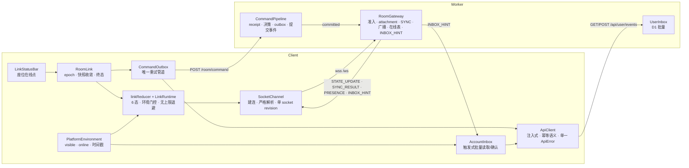

# 实时链路重做方案（RoomLink v3）

> 状态：已实施（PR #332，分支 `refactor/realtime-link-v3`）。本文是 RoomLink v3 的现行设计依据；
> §1–§2 的“现状”与删除清单记录的是重做前的旧系统，仅作历史对照。
> 范围：删除现有重连系统及其相邻层（连接核心、传输、会话、命令恢复、音频 ACK 重试、HTTP 客户端、
> 平台环境源、Worker 命令管线、Worker WebSocket 网关、账号事件收件箱、状态条 UI、E2E、文档），
> 从零建立一套新系统。不保留兼容层，不双轨运行。
> 本文所有“现状”均核对自 2026-10-28 的源码；所有“社区做法”均注明来源。

---

## 0. 原则

1. **Fail fast。** 协议、身份、revision、存储完整性任何一项不符合契约立即抛错 / 关闭连接 / 上报，不降级成业务 reason，不静默忽略。
2. **不做防御性编程。** 不为“理论上可能”的输入写兜底；类型系统已保证的字段不加 `?.`；边界只在系统入口（HTTP body、WebSocket 帧、持久化读取）做一次严格解析。
3. **不打补丁。** 同一个关注点只有一处实现：一条重试管道、一个环境源、一个连接状态机、一个 HTTP 客户端。任何“再加一层监听以防漏掉”的方案直接否决。
4. **删除即删除。** 旧文件整树移除，旧消息类型、旧 close code、旧存储 key 不保留识别逻辑。
5. **不兼容旧房间。** 2026-10-28 用户决定：本次重做不为部署前已存在的房间提供迁移；DO SQLite / D1 表结构可以自由重设计。部署后旧房间视为不存在。
6. **服务端唯一权威。** 客户端只提交 intent、接收快照；没有本地推演。

---

## 1. 现状与处置

### 1.1 删除（整文件，含对应 `__tests__`）

| 区域             | 文件                                                                                                                                                                                                                                                                                                   | 现状问题                                                                                                                                                                  |
| ---------------- | ------------------------------------------------------------------------------------------------------------------------------------------------------------------------------------------------------------------------------------------------------------------------------------------------------ | ------------------------------------------------------------------------------------------------------------------------------------------------------------------------- |
| 连接核心         | `src/services/connection/ConnectionFSM.ts`（712 行）、`ConnectionManager.ts`（540 行）、`backoff.ts`、`types.ts`                                                                                                                                                                                       | 8 态 × 17 事件，环境事件在每个状态重复处理；15 次封顶进 Failed；前台恢复固定在原 socket 上等 10 秒                                                                        |
| 传输             | `src/services/cloudflare/CFRealtimeService.ts`、`src/services/types/IRealtimeTransport.ts`                                                                                                                                                                                                             | token 在 query string；只把 close 1002 当终态                                                                                                                             |
| 会话             | `src/features/room/session/`（14 文件：RoomSession、LazyRoomSession、RoomCommandRecovery、roomCommandClient、GameSessionFactory、ActiveRoomSessionOwner、types、roomCommandResult、createRoomCommandFailureMessage、roomSeatCommandClient、roomProfileCommandClient、SessionRoomAccountCapability 等） | 对外契约含 `acknowledgeRecoveredCommandRejection` 这类补丁式 API；`connect()` 15 秒硬超时与重连路径“15 次”不一致                                                          |
| 命令持久化       | `src/features/room/services/RoomCommandRecoveryStore.ts`、`storageKeys.ROOM_COMMAND_RECOVERY_KEY`                                                                                                                                                                                                      | 随会话层一起重做                                                                                                                                                          |
| 组装             | `src/app/CloudflareGameSessionFactory.ts`                                                                                                                                                                                                                                                              | 随会话层一起重做                                                                                                                                                          |
| HTTP 客户端      | `src/services/cloudflare/cfFetch.ts`（677 行）                                                                                                                                                                                                                                                         | 模块级可变单例（`tokenProvider` / `refreshHandler` / `onAuthExpired` / `refreshPromise`），`noRetry` / `skipAuthIntercept` 布尔开关而非幂等语义，三种错误类               |
| 平台环境         | `src/services/infra/appVisibility.ts`                                                                                                                                                                                                                                                                  | 只有可见性；在线状态由 `ConnectionManager` 自己监听 `window.online`，两处分裂；无时间戳                                                                                   |
| 音频 ACK 重试    | `src/features/room/audio/RoomAudioOrchestrator.ts` L405–505（check + listen + poll，“L3a”）、`ConnectionStatus.Live` 监听重试、`src/games/werewolf/runtime/__tests__/WerewolfAudioOrchestrator.reconnect.test.ts`                                                                                      | 与命令恢复平行的第二套重试系统                                                                                                                                            |
| 账号收件箱客户端 | `src/features/account/hooks/useAccountEvents.ts`                                                                                                                                                                                                                                                       | 30 秒轮询；逐条 GET/ack                                                                                                                                                   |
| 死代码           | `CFRoomDirectoryService.deleteRoom()` 与 `RoomDirectory.deleteRoom` 接口                                                                                                                                                                                                                               | `src/` 内无调用方；随 `cfFetch` 调用点迁移一并删除。服务端 `POST /room/delete` 保留给 saga / 测试                                                                         |
| UI               | `src/features/room/components/ConnectionStatusBar.tsx`、`src/features/room/model/RoomConnection.ts`、`RoomShellModel.connection`                                                                                                                                                                       | 状态枚举为字符串，无终态原因、无倒计时                                                                                                                                    |
| 共享协议         | `packages/game-engine/src/platform/protocol/roomSnapshot.ts` 中 `StateUpdateMessage` / `StateSyncRequestMessage` / `StateSyncResponseMessage` 及 create / parse；`RoomSnapshot` / `BaseGameState` / `GameStateCodec` 保留                                                                              | 同步请求不带 `knownRevision`；无共享 close code                                                                                                                           |
| Worker 网关      | `packages/api-worker/src/platform/room/webSocketRoutes.ts`；`GameRoomRuntime.ts` 中 `fetch` / `#handleWebSocketUpgrade` / `webSocketMessage` / `webSocketClose` / `webSocketError` / `#broadcast` / `#recordRealtimeTraffic` 及构造函数 `setWebSocketAutoResponse`                                     | 准入失败返回 HTTP 4xx，浏览器只能看到 1006；`room_deleted` 用 1000、`state_unavailable` 用 1011；`#broadcast` 在三处手工调用（dispatch / terminalize / dispatchInternal） |
| Worker 命令管线  | `packages/api-worker/src/platform/room/actionPipeline.ts`、`roomRepository.ts`（666 行）、`effectOutbox.ts`、`types.ts` 中 `DispatchRoomResult`                                                                                                                                                        | `DispatchRoomResult` 与 `PipelineDispatchResult` 两层包装；广播职责散落在 DO 方法里                                                                                       |
| 账号收件箱服务端 | `packages/api-worker/src/platform/userEvents/inbox.ts`、`features/account/routes.ts` 中 events 路由                                                                                                                                                                                                    | 逐条读取/确认；无批量                                                                                                                                                     |
| E2E              | `e2e/specs/resilience-reconnect.spec.ts`；`e2e/helpers/waits.ts` 中 `ensureConnected` / `waitForPageReconnect` / `DISCONNECTED_BANNER_TEXT`                                                                                                                                                            | 绑定旧文案和旧状态                                                                                                                                                        |
| 文档             | `docs/network-resilience-design.md`、`docs/room-session-lifecycle.md`                                                                                                                                                                                                                                  | §6 描述的 socket 上 `USER_EVENT_ACK` 已不存在（实际走 HTTP）；归档到 `docs/archive/`                                                                                      |

### 1.2 保留但不属于本方案

- 认证本体：`CFAuthService`、refresh token 轮换、`accessTokenClaims.ts`。新 `ApiClient` 通过接口消费它。
- 游戏引擎 `decidePublic` / `decideInternal`、各游戏 Worker module、effect handler 业务逻辑。
- `packages/api-worker/src/platform/room/roomDirectory.ts`（D1 房间目录）、`roomStub.ts`、`roomSaga.ts`。
- Analytics Engine 流量记录函数 `recordRealtimeTraffic` 本体；由新网关调用。

### 1.3 持久化结构的处置（不兼容旧房间）

| 存储                                                                                                                              | 处置                                                                                                                                                                                                                                                                                                                    |
| --------------------------------------------------------------------------------------------------------------------------------- | ----------------------------------------------------------------------------------------------------------------------------------------------------------------------------------------------------------------------------------------------------------------------------------------------------------------------- |
| DO SQLite `room_state` / `command_receipts` / `effect_outbox` / `effect_replays` / `_sql_schema_migrations`（`storageSchema.ts`） | **按新管线重新设计，删除 `_sql_schema_migrations` 迁移机制。** DO 唤醒时若存储非空且不是当前 schema → `storage.deleteAll()`，房间按未初始化处理（命令返回 `unavailable`，socket 以 4003 关闭）。D1 目录中指向这些 DO 的条目由现有 stale room 回收路径处理（实施时核对 `maintenance.ts` / `roomDirectory.ts`，不做假设） |
| D1 `user_event_inbox`                                                                                                             | 可重设计；至少补齐批量读取 / 批量确认所需索引。未确认事件在部署时间点之前的可丢弃                                                                                                                                                                                                                                       |
| 客户端 `localStorage` / MMKV 命令恢复 key                                                                                         | 旧 key 废弃不读取                                                                                                                                                                                                                                                                                                       |

---

## 2. 目标架构



### 2.1 新模块树

```
packages/game-engine/src/platform/realtime/
  protocol.ts            客户端↔服务端消息联合类型 + 严格 parser（zod v4）
  closeCodes.ts          共享关闭码枚举 + isTerminalCloseCode()

packages/api-worker/src/platform/realtime/
  RoomGateway.ts         DO 内组合对象：准入、attachment、SYNC、广播、在线表、INBOX_HINT
  gatewayRoute.ts        /ws：鉴权 + 房间目录解析 + 升级；失败 = 升级后 4xxx 关闭
packages/api-worker/src/platform/commands/
  CommandPipeline.ts     receipt 查重 → 决策 → 事务持久化 → 返回 CommandDecision + 提交事件
  CommandReceipts.ts     command_receipts 读写
  EffectOutbox.ts        effect_outbox 读写
  RoomStateStore.ts      room_state 读写
  storageSchema.ts       单一 schema 版本；非当前 schema 的存储整体丢弃
packages/api-worker/src/platform/userInbox/
  inbox.ts               enqueue / readBatch / acknowledgeBatch
  routes.ts              GET /api/user/events?limit · POST /api/user/events/ack

src/platform/env/
  PlatformEnvironment.ts 单一环境源：{ visible, online, visibleSinceMs, onlineSinceMs }
src/platform/http/
  ApiClient.ts           注入式客户端；AuthTokenSource 接口；幂等重试；单一 ApiError
  ApiError.ts
src/platform/realtime/
  RoomLink.ts            对外唯一入口
  linkReducer.ts         纯函数 reducer
  LinkRuntime.ts         命令式外壳（计时器、环境订阅、side effect）
  SocketChannel.ts       WebSocket 封装
  CommandOutbox.ts       本地待确认命令
  commandTransport.ts    单次 POST /room/command + 结果解析
  outboxStorage.ts       持久化抽象（web localStorage / native MMKV）
  types.ts               LinkSnapshot / LinkStatus / CloseReason / DispatchOutcome / PreparedCommand
src/platform/inbox/
  AccountInbox.ts        触发式收件箱消费者
src/features/room/
  components/LinkStatusBar.tsx
  controllers/useRoomLink.ts
```

命名：`src/platform/` 为平台层（不含任何游戏概念），与 `packages/game-engine/src/platform/` 对应。`src/services/` 中与本方案重叠的文件删除后，该目录只剩音频、存储、认证等基础设施。

---

## 3. 契约

### 3.1 共享协议 v2（`platform/realtime/protocol.ts`）

```ts
// 客户端 → 服务端。心跳是字面量 'ping'，由 DO setWebSocketAutoResponse 应答，不进入此联合。
type ClientFrame = { type: 'SYNC'; requestId: string; knownRevision: number | null };

// 服务端 → 客户端
type ServerFrame<TState> =
  | { type: 'SYNC_RESULT'; requestId: string; outcome: 'current'; revision: number }
  | { type: 'SYNC_RESULT'; requestId: string; outcome: 'snapshot'; snapshot: RoomSnapshot<TState> }
  | { type: 'STATE_UPDATE'; snapshot: RoomSnapshot<TState>; commandType: string | null }
  | { type: 'PRESENCE'; onlineUserIds: readonly string[] }
  | { type: 'INBOX_HINT' };
```

- parser 用 zod v4 `strictObject` + `discriminatedUnion`（game-engine 新增 `zod` 运行时依赖，与 Worker 同版本），多余字段即协议错误；失败抛 `RealtimeProtocolError`，message 为 `z.prettifyError` 输出。
- `RoomSnapshot` 的 `state` 仍由各游戏 `GameStateCodec` 解码；解码失败即协议错误。

### 3.2 关闭码（`platform/realtime/closeCodes.ts`）

| 码                                                | 名称                     | 发起方 | 客户端行为                                                                                                                                                           |
| ------------------------------------------------- | ------------------------ | ------ | -------------------------------------------------------------------------------------------------------------------------------------------------------------------- |
| 1002                                              | `PROTOCOL_ERROR`         | 双方   | 终态 `closed(protocol)`，上报 Sentry                                                                                                                                 |
| 4000                                              | `ROOM_DELETED`           | 服务端 | 终态 `closed(roomDeleted)` → 提示“房间已过期关闭”，退出房间。触发点只有定时任务 `expireStaleRooms`（24 小时）经 saga 调用 `deleteRoomStorage`；UI 没有“解散房间”入口 |
| 4001                                              | `ROOM_INSTANCE_MISMATCH` | 服务端 | 终态 `closed(instanceMismatch)` → 退出房间                                                                                                                           |
| 4002                                              | `AUTH_REJECTED`          | 服务端 | 终态 `closed(authRejected)` → 走登录过期流程                                                                                                                         |
| 4003                                              | `STATE_UNAVAILABLE`      | 服务端 | 终态 `closed(stateUnavailable)`，上报 Sentry                                                                                                                         |
| 其他（1000 / 1001 / 1005 / 1006 / 1011 / 1012 …） | —                        | —      | 可重试                                                                                                                                                               |

Cloudflare Agents 文档（2026-10-27）中准入失败即 `connection.close(4001, 'Unauthorized')`，即“升级后以 4xxx 关闭”的做法。

### 3.3 WebSocket 鉴权

access token 继续通过 query string 传递（Cloudflare Agents 文档示例做法）。原因：浏览器 `WebSocket` 构造函数无法设置 header；`Sec-WebSocket-Protocol` 承载 token 是变通而非标准。约束：

- 建连前用 `AuthTokenSource.ensureFresh()` 取得未过期 token（与 HTTP 401 refresh 共享 single-flight）。
- `/ws` 路由鉴权失败不返回 HTTP 401，而是升级后 `close(4002)`。
- Worker 日志不记录 query string（在 gatewayRoute 中用 `url.search = ''` 后再写日志 / 上报）。

### 3.4 客户端 `RoomLink`

```ts
interface RoomLink<TState extends BaseGameState<string>, TCommand extends object> {
  readonly snapshot: LinkSnapshot<TState>;
  subscribe(listener: () => void): () => void;
  /** 只在终态 reject；网络差不 reject，由 snapshot.status 表达。 */
  connect(identity: RoomIdentity, signal: AbortSignal): Promise<void>;
  prepare<C extends TCommand>(command: C, controlledSeat: number | null): PreparedCommand<C>;
  dispatch(command: TCommand, options: DispatchOptions): Promise<DispatchOutcome<TState>>;
  dispatchPrepared(
    prepared: PreparedCommand<TCommand>,
    label: string,
  ): Promise<DispatchOutcome<TState>>;
  /** waiting 下立即重连并把 attempt 归零；其他状态调用是编程错误，抛错。 */
  retryNow(): void;
  close(): void;
}

interface DispatchOptions {
  readonly controlledSeat: number | null;
  readonly label: string; // 中文，用于日志与失败提示
  readonly durable: boolean; // true：持久化并跨连接重放，直到服务端给出决定
}

type LinkStatus =
  | { kind: 'idle' }
  | { kind: 'connecting'; attempt: number }
  | { kind: 'syncing' }
  | { kind: 'live' }
  | {
      kind: 'waiting';
      cause: 'offline' | 'hidden' | 'backoff';
      attempt: number;
      nextRetryAtMs: number | null;
    }
  | { kind: 'closed'; reason: CloseReason };

type CloseReason =
  | 'roomDeleted'
  | 'instanceMismatch'
  | 'authRejected'
  | 'stateUnavailable'
  | 'protocol'
  | 'released';

interface LinkSnapshot<TState> {
  readonly epoch: number;
  readonly identity: RoomIdentity | null;
  readonly status: LinkStatus;
  readonly room: RoomSnapshot<TState> | null;
  readonly lastCommand: { readonly revision: number; readonly type: string } | null;
  readonly pendingDurableCount: number;
  readonly presence: ReadonlySet<string>; // 未收到 PRESENCE 前为空集合
}

type DispatchOutcome<TState> =
  | {
      kind: 'committed';
      commandId: string;
      snapshot: RoomSnapshot<TState>;
      outcome: CommittedOutcome;
    }
  | { kind: 'rejected'; commandId: string; reason: string }
  | { kind: 'unavailable'; commandId: string } // 404 no_state，保留意图
  | { kind: 'undelivered'; commandId: string; cause: 'network' | 'timeout' | 'server' } // 保留意图
  | { kind: 'cancelled'; commandId: string }; // 会话结束 / signal abort
```

与旧契约的差异（方案 X）：

- `RoomSessionSnapshot.connection: string` → 结构化 `LinkStatus`；`phase` 由 `status` + `room !== null` 推导，不再单独存。
- `acknowledgeRecoveredCommandRejection` / `lastRecoveredCommandRejection` 删除。durable 命令在重放时被拒绝，通过 `DispatchOutcome` 回到最初的 `dispatch()` promise（promise 在整个 durable 生命周期内保持 pending，直到决定或会话结束），调用方自己决定提示。
- `RoomCommandDispatchOutcome` 的 `decided / notDecided / deliveryUnknown` 三层 → 扁平五种。
- `isRecoverable` → `durable`。

### 3.5 `ApiClient`

```ts
interface AuthTokenSource {
  current(): string | null;
  ensureFresh(): Promise<string | null>; // single-flight refresh；过期返回 null 并触发登出流程
  session(): AuthSession | null; // 请求绑定身份，身份变化 → AbortError
}

interface ApiClient {
  request<T>(spec: RequestSpec<T>): Promise<T>;
}

interface RequestSpec<T> {
  readonly method: 'GET' | 'POST' | 'PUT';
  readonly path: string;
  readonly body?: Record<string, unknown> | Blob | FormData;
  readonly decode: (value: unknown) => T; // zod schema.parse 或自定义
  readonly idempotent: boolean; // 只有 true 才允许网络层重试
  readonly timeoutMs?: number;
  readonly signal?: AbortSignal;
}

class ApiError extends Error {
  readonly kind: 'http' | 'network' | 'timeout' | 'aborted' | 'contract';
  readonly status: number | null;
  readonly reason: string | null; // 服务端 { reason } 或 { error }
}
```

- 无模块级可变状态；`ApiClient` 实例由 `ServiceContext` 注入，测试直接构造。
- 401 处理：一次 `ensureFresh()` 后重发一次；仍 401 → `ApiError(kind:'http', status:401, reason:'AUTH_EXPIRED')`。
- 非 JSON 的 2xx、JSON 不符合 `decode` → `kind:'contract'`（fail fast，不是业务错误）。
- `room/command` 的 `idempotent: true`（commandId receipt 保证）；抽卡等非幂等端点 `idempotent: false`。

### 3.6 `PlatformEnvironment`

```ts
interface EnvironmentSnapshot {
  readonly visible: boolean;
  readonly online: boolean;
  readonly visibleSinceMs: number; // 最近一次进入当前 visible 值的时刻
  readonly onlineSinceMs: number;
}
```

- Web：`document.visibilitychange` + `window.pageshow` + `window.focus` + `window.online/offline`；初值 `document.visibilityState` / `navigator.onLine`。
- Native：`AppState`；在线状态无 NetInfo 依赖（package.json 未安装），`online` 恒为 `true`，由 socket 失败驱动重连。本方案不引入 NetInfo。
- 唯一订阅源；`LinkRuntime` 与 `AccountInbox` 都订阅它。

### 3.7 账号收件箱 HTTP 契约

```
GET  /api/user/events?limit=20        → { events: [{ eventId, message }], hasMore: boolean }
POST /api/user/events/ack             { eventIds: string[] } → { acknowledged: number }
```

- 服务端按 `(created_at, event_id)` 排序；`acknowledgeBatch` 只删除认证用户自己的行。
- 客户端 `AccountInbox` 触发时机：登录后、`visible` 变为 true、`RoomLink` 进入 `live`、收到 `INBOX_HINT`。不再有 30 秒轮询。
- 无法解码的事件：上报 Sentry 后确认（dead-letter），与现状一致；这是收件箱消费者的标准处置，不是吞错。

---

## 4. 客户端行为规范

### 4.1 reducer

上下文：`status, online, visible, visibleSinceMs, attempt, liveSinceMs, knownRevision, socketGeneration, pendingSyncRequestId`。

事件：`CONNECT, SOCKET_OPEN, SOCKET_CLOSED(code, reason), SYNC_RESULT, STATE_UPDATE, SYNC_DEADLINE, PONG_DEADLINE, PING_DUE, ENV(snapshot), TIMER, RETRY_NOW, CLOSE`。

side effect：`OPEN_SOCKET(generation) | CLOSE_SOCKET(generation, code) | SEND_SYNC(requestId, knownRevision) | SEND_PING | ARM_TIMER(kind, atMs) | DISARM_TIMER(kind) | EMIT_SNAPSHOT | EMIT_PRESENCE | EMIT_INBOX_HINT`。

| 当前                                  | 事件                                       | 下一状态                                         | 效果                                               |
| ------------------------------------- | ------------------------------------------ | ------------------------------------------------ | -------------------------------------------------- |
| idle                                  | CONNECT                                    | connecting(attempt 0) 或 waiting(offline/hidden) | OPEN_SOCKET 或无                                   |
| connecting                            | SOCKET_OPEN                                | syncing                                          | SEND_SYNC(knownRevision)、ARM(sync, +5s)           |
| connecting                            | SOCKET_CLOSED(可重试) / TIMER(connect, 8s) | waiting(backoff)                                 | ARM(retry, nextRetryAt)                            |
| syncing                               | SYNC_RESULT(匹配 requestId)                | live                                             | DISARM(sync)、ARM(ping, +25s)、`liveSinceMs = now` |
| syncing                               | SYNC_RESULT(不匹配) / 未知帧               | closed(protocol)                                 | CLOSE_SOCKET(1002)                                 |
| syncing                               | STATE_UPDATE                               | syncing                                          | 按 revision 规则应用快照，不越过同步屏障           |
| syncing                               | SYNC_DEADLINE / SOCKET_CLOSED              | waiting(backoff)                                 | CLOSE_SOCKET、ARM(retry)                           |
| live                                  | PING_DUE                                   | live                                             | SEND_PING、ARM(pong, +10s)                         |
| live                                  | STATE_UPDATE / pong                        | live                                             | DISARM(pong)、ARM(ping, +25s)                      |
| live                                  | PONG_DEADLINE / SOCKET_CLOSED(可重试)      | waiting(backoff)                                 | CLOSE_SOCKET、ARM(retry)                           |
| live                                  | ENV(visible=false)                         | live                                             | DISARM(ping, pong)                                 |
| live                                  | ENV(visible=true)                          | syncing 或 connecting                            | 见 4.3                                             |
| live / syncing / connecting           | ENV(online=false)                          | waiting(offline)                                 | CLOSE_SOCKET(1000)、DISARM(all)；计一次失败尝试    |
| live / syncing / connecting / waiting | SOCKET_CLOSED(终态码)                      | closed(reason)                                   | DISARM(all)                                        |
| waiting                               | TIMER(retry) / ENV / RETRY_NOW             | connecting 或 waiting                            | `canAttempt = online && visible` 决定              |
| 非 waiting                            | RETRY_NOW                                  | 不变                                             | 无（按钮与 retry 计时器的竞态，不是编程错误）      |
| 任意非 closed                         | CLOSE                                      | closed(released)                                 | CLOSE_SOCKET(1000)、DISARM(all)                    |

- `attempt` 只在 `live` 持续 ≥ 5 秒（`MIN_UPTIME_MS`）后归零；抖动场景不会把退避重置为 0。来源：PartySocket `minUptime: 5000`。
- 没有最大次数。来源：PartySocket `maxRetries: Infinity`。

### 4.2 退避

`delay = random(0, min(CAP, BASE * 2 ** attempt))`，`BASE = 1_000`，`CAP = 10_000`（PartySocket `maxReconnectionDelay: 10000`），第 0 次（`attempt === 0`）立即重连。full jitter 来源：AWS Architecture Blog “Exponential Backoff And Jitter”。

### 4.3 前台恢复

`ENV(visible: true)` 且当前 `live`：

- `now - visibleSinceMs(上一次 hidden 起点) < FAST_RESUME_MAX_HIDDEN_MS (20_000)` 且 socket 仍 OPEN → `syncing`，原 socket `SEND_SYNC(knownRevision)`，截止 5 秒。
- 否则 → `CLOSE_SOCKET(1000)`，`connecting(attempt 0)`，直接新建 socket。

阈值取错的代价被 5 秒同步截止限定，不影响正确性。

### 4.4 心跳

`PING_INTERVAL_MS = 25_000`、`PONG_TIMEOUT_MS = 10_000`，只在 `live && visible` 时运行。`ping` 由 DO auto-response 应答，不唤醒 DO。

### 4.5 快照收敛（`RoomLink`）

- 任何来源（`SYNC_RESULT.snapshot` / `STATE_UPDATE` / 命令 `committed`）的快照先校验 `gameType === identity.gameType`、`state.roomCode === identity.roomCode`、`state.hostUserId === identity.hostUserId`，不符即 `closed(protocol)`。
- `revision < current` 忽略；`revision === current` 要求 canonical JSON 相同，否则 `closed(protocol)`；`revision > current` 替换。
- 单 socket 内 `STATE_UPDATE.revision` 必须严格递增，否则 `CLOSE_SOCKET(1002)`；`SYNC_RESULT` 不受此约束。

### 4.6 `CommandOutbox`

- 意图键：`canonicalJson({ controlledSeat, command })`；同键共享一个 `commandId` 与一个 in-flight promise。
- `durable: true` 的意图在首次发送前写入 `outboxStorage`（key 含 `roomId + userId`），`committed / rejected` 时删除；`unavailable / undelivered` 保留。
- 单次发送：`ApiClient.request({ idempotent: true })`，不在 transport 层再做业务重试。
- 重放：只在 `status.kind === 'live'` 时进行；每条记录绑定 `socketGeneration`，同一代只重放一次；换代后立即重放。失败后下一次重放等待 `live` 且 `[1s, 3s, 10s, 30s]` 递进。
- 命令结果到达时若 `epoch` 已变 → `cancelled`，不应用快照。
- **音频 ACK 是一条 `durable: true` 的普通命令**，没有任何独立重试逻辑；重连后若快照里仍有 `pendingAudioEffects`，音频编排器按快照重新播放再 ACK，receipt 保证同 ID 幂等。

### 4.7 在线状态

`PRESENCE` 到达即替换 `snapshot.presence`。`RoomSeatViewModel` 新增 `isOnline: boolean`（真人座位且 userId ∈ presence）；机器人座位恒 `true`。

静默断网（飞行模式、进程被杀、WiFi 断开）不会产生 Close 帧，ping/pong 又由运行时 auto-response 回答、不唤醒 DO，所以服务端只能靠周期性扫描发现半开 socket。离线点从断网到出现的上界 = 60 秒陈旧阈值 + 30 秒扫描间隔。

---

## 5. Worker 行为规范

### 5.1 `compatibility_date → 2026-10-01`

三份 wrangler 配置同步。关注的默认开启 flag：

| flag                                       | 默认       | 影响                                                                                                                                                                                                               |
| ------------------------------------------ | ---------- | ------------------------------------------------------------------------------------------------------------------------------------------------------------------------------------------------------------------ |
| `web_socket_auto_reply_to_close`           | 2026-04-07 | 服务端收到 Close 自动回应，`getWebSockets()` 不再长期返回 CLOSING 的 socket；`webSocketClose` 里不再需要 `ws.close()`                                                                                              |
| `durable_object_io_tasks_prevent_eviction` | 2026-10-01 | 待完成 I/O 保活 DO ≤ 15 分钟；outbox alarm 中的外部 fetch 不会被驱逐打断                                                                                                                                           |
| `enable_nodejs_global_timers`              | 2026-02-10 | `setTimeout` 返回 Node `Timeout` 对象；Worker 代码里需检查 `ReturnType<typeof setTimeout>` 的用法（当前 grep 无命中）                                                                                              |
| `enable_fast_jsg_struct`                   | 2025-12-03 | 运行时 API 结构体的可选字段显式为 `undefined`；`'x' in obj` 判断需复查（当前命中 `callDurableObject.ts` 三处、`mediaRoutes.ts` 两处、`GameRoomRuntime.ts` 一处，均是对自有对象的判断，不受影响，但实施时逐个确认） |
| `nodejs_compat` 默认                       | 2026-08-04 | 现有 `compatibility_flags = ["nodejs_compat"]` 可保留                                                                                                                                                              |

升级单独成一个提交，Worker 测试全量通过后再进入网关改动。

### 5.2 `RoomGateway`

- 准入：`gatewayRoute` 完成鉴权与目录解析；任何失败都升级后 `close(4002 / 4001 / 4000)`。
- `ctx.acceptWebSocket(ws, [\`user:${userId}\`])`+`ws.serializeAttachment({ userId, connectedAtMs })`（≤ 16 KB）。
- `webSocketMessage`：只接受文本帧；解析失败 → `close(1002)`；`SYNC`：`knownRevision === room.revision` → `current`，否则 `snapshot`；房间无快照 → `close(4003)` + Sentry。
- 广播：`CommandPipeline` 返回 `{ decision, broadcast }`，`RoomGateway.broadcastState()` 是 DO 内唯一的广播入口；`GameRoom` 不再在三处手工调用。
- 在线表：accept / close 时，按 tag 去重 userId，广播 `PRESENCE`；计算时对 `getWebSocketAutoResponseTimestamp(ws)` 距今 > 60 秒且 `connectedAtMs` 距今 > 60 秒的 socket 调用 `close(1001)`。有 OPEN socket 期间每 30 秒由 DO alarm 执行一次 `sweep()`：在线集合与上次广播相同则静默，否则广播；无 OPEN socket 时不续约。DO 的单一 alarm 由 `GameRoomRuntime.#scheduleAlarm()` 取 outbox 下一到期时间与下一次扫描时间的最小值。服务端发起的 `close()` 在对端应答前仍会出现在 `getWebSockets()` 中，所有遍历只看 `readyState === OPEN` 的 socket。
- `INBOX_HINT`：`publishUserEvent` 写入 D1 成功后，对 `getWebSockets(\`user:${userId}\`)` 发送一帧。无 socket 时静默（客户端其他触发时机覆盖）。
- 流量记录：所有出入帧经 `recordRealtimeTraffic`。

### 5.3 `CommandPipeline`

- 对外一个函数 `dispatch(request): Promise<CommandDispatch>`：

```ts
type CommandDispatch =
  | {
      kind: 'decided';
      decision: RoomCommandResult;
      isReplay: boolean;
      broadcast: boolean;
      commandType: string | null;
    }
  | { kind: 'unavailable' }; // 房间未初始化 / 已删除
```

- receipt 语义不变：同 ID 同 canonical 请求 → 原决定；同 ID 不同身份 / body → `command_id_conflict`。
- 引擎决策、receipt、state、effect outbox 在一个 `storage.transaction` 内完成。
- 三类调用点（用户命令、effect 内部命令、outbox 终态命令）都经过它，广播由返回值驱动。

---

## 6. 方案 X 迁移清单

旧契约引用共 93 个文件（2026-10-28 grep）。按组迁移：

| 组                | 文件                                                                                                                                                                                                                    | 改动                                                                                              |
| ----------------- | ----------------------------------------------------------------------------------------------------------------------------------------------------------------------------------------------------------------------- | ------------------------------------------------------------------------------------------------- |
| 游戏 session 包装 | `src/games/{avalon,demo,drawguess,fibking,pictionary,storyrelay,undercover}/model/*RoomSession.ts`、`src/games/werewolf/runtime/WerewolfGameClient*.ts`                                                                 | `RoomSessionClient` → `RoomLink`；`isRecoverable` → `durable`                                     |
| 房间 controllers  | `src/features/room/controllers/useRoom{Entry,Seat,Profile,Host,Command,Config}*.ts`、`useRoomSessionSnapshot.ts`、`useStandardSeatCommands.ts`                                                                          | 读 `LinkStatus`；`manualReconnect` → `retryNow`；删除 `acknowledgeRecoveredCommandRejection` 用法 |
| 结果判定          | 所有 `isSuccessfulRoomCommand` / `getRoomCommandFailureReason` 调用（executors、`useActionOrchestrator`、`useInteractionDispatcher`、`useRoomModals`、`BoardNominationList`、`SettingsScreen`、`useAppearanceSave` 等） | 改用 `DispatchOutcome` 五种 kind 的判别                                                           |
| 失败文案          | 8 个 `*RoomCommandFailureMessage.ts`                                                                                                                                                                                    | 输入类型改为 `DispatchOutcome`                                                                    |
| 自动提交          | `usePictionaryAutoSubmission.ts`（当前还 import 了旧 `calculateBackoff`）、`useStoryRelayAutoSubmission.ts`、`useDrawGuessRoomState.ts`、`useAvalonRoomState.ts`                                                        | 读 `pendingDurableCount` 与 `status.kind === 'live'`                                              |
| 音频              | `RoomAudioOrchestrator.ts`、`WerewolfAudioOrchestrator.ts`、`useAvalonAudioOrchestration.ts`                                                                                                                            | ACK 走 `dispatch({ durable: true })`；删除重试段                                                  |
| Shell / UI        | `RoomShell.tsx`、`RoomShellModel.ts`、`createRoomShellModel.ts`、`RoomEntryBoundary.tsx`、`WerewolfAppOverlay`、`AIChatBubble`                                                                                          | `connection` 字段 → `link: LinkStatus & { pendingDurableCount }`                                  |
| 模块注册          | `ClientGamePlugin.ts`、`defineClientGameModule.ts`、`werewolf/module.ts`、`CloudflareGameSessionFactory.ts`                                                                                                             | `GameSessionFactory` → `RoomLinkFactory`                                                          |
| 测试工具          | `src/test-utils/roomCommand.ts` 及所有测试 fixture                                                                                                                                                                      | 新 shape                                                                                          |

---

## 7. 实施顺序

单分支、单 PR，中间提交允许编译不过；最终合入前 `pnpm run quality` 全绿。

| 步  | 内容                                                                                                                                                                  | 门禁                                                                        |
| --- | --------------------------------------------------------------------------------------------------------------------------------------------------------------------- | --------------------------------------------------------------------------- |
| 1   | Worker `compatibility_date` 升级                                                                                                                                      | Worker vitest 全量                                                          |
| 2   | 共享协议 v2 + 关闭码；删除旧消息类型                                                                                                                                  | game-engine 测试                                                            |
| 3   | Worker：`CommandPipeline` 重做（新 schema）、`RoomGateway` + `gatewayRoute`、`userInbox` 批量接口；删除旧 ws 代码、`actionPipeline.ts`、`_sql_schema_migrations` 机制 | Worker vitest 全量；非当前 schema 存储 → `deleteAll` + `unavailable` 的测试 |
| 4   | 客户端 `PlatformEnvironment`、`ApiClient` / `ApiError`；删除 `cfFetch.ts`、`appVisibility.ts`，迁移全部 `cfGet/cfPost/cfPut/cfUpload/cfPutBinary/cfGetBinary` 调用点  | 客户端 Jest 全量                                                            |
| 5   | 客户端 `src/platform/realtime/` 全新实现 + 测试（reducer 表驱动穷举、Outbox、SocketChannel 假 socket）                                                                | 新测试全绿                                                                  |
| 6   | 删除 §1.1 客户端旧文件；按 §6 迁移 93 个引用点                                                                                                                        | tsc + Jest 全量                                                             |
| 7   | 音频 ACK 改 durable 命令，删除补丁                                                                                                                                    | 狼人杀 / 阿瓦隆音频测试                                                     |
| 8   | `AccountInbox` 触发式消费；删除 `useAccountEvents.ts`                                                                                                                 | 账号测试                                                                    |
| 9   | `LinkStatusBar`（倒计时 + 立即重连 + 终态文案）、座位在线点                                                                                                           | Board UI 契约测试                                                           |
| 10  | E2E 重写：断网 5s / 30s / 抖动 5 次 / 房主断网；新增房间解散、后台 30s 回前台、服务端关闭全体 socket（模拟部署）、在线点                                              | `pnpm run e2e`                                                              |
| 11  | 文档：本文件转正为设计文档，旧两份归档；`services.instructions.md` 音频 ACK 段落重写；`pnpm run sync:agents`                                                          | `sync:agents:check`                                                         |

部署顺序：Worker 先、Pages 后。旧页面收到未知帧以 1002 进终态并提示“版本已更新，请刷新”。

---

## 8. 测试矩阵

| 层              | 覆盖                                                                                  |
| --------------- | ------------------------------------------------------------------------------------- |
| reducer         | 每个 (状态, 事件) 组合的输出；退避区间；`MIN_UPTIME` 归零规则；前台双路径；终态码集合 |
| SocketChannel   | 代次失效；单 socket revision 单调；非文本帧 / 非法 JSON / 多余字段 → 1002             |
| CommandOutbox   | 同意图合并；durable 持久化与删除；换代重放一次；epoch 变更 → cancelled                |
| RoomLink        | 身份校验；revision 收敛三分支；`connect` 只在终态 reject；`retryNow` 非 waiting 抛错  |
| ApiClient       | 401 一次 refresh；`idempotent:false` 不重试；contract 错误不是业务错误                |
| Worker Gateway  | 升级后 4xxx；SYNC current / snapshot；PRESENCE 去重与半开清理；INBOX_HINT 定向        |
| Worker Pipeline | receipt 重放 / 冲突；三类调用点广播由返回值驱动；事务回滚                             |
| E2E             | §7 第 10 步                                                                           |

---

## 9. 决策记录

| 项                                   | 决定                                                                          |
| ------------------------------------ | ----------------------------------------------------------------------------- |
| 对外契约                             | 方案 X：内部与契约都重做，93 个引用点迁移                                     |
| 命令管线 / cfFetch / 环境源 / 收件箱 | 纳入重做；DO SQLite 与 D1 表结构按新设计重建                                  |
| 旧房间                               | 不兼容（2026-10-28 用户决定）；部署后旧房间视为不存在，覆盖 2026-09-19 的要求 |
| 重连上限                             | 无上限；只有终态停止                                                          |
| 进房超时                             | 取消 15 秒硬失败；`connect()` 只在终态 reject                                 |
| WS 鉴权                              | query string（Cloudflare Agents 文档做法）+ 升级后 4002                       |
| compat date                          | 2026-10-01                                                                    |
| 在线状态 PRESENCE                    | 做，含座位在线点                                                              |
| 账号收件箱                           | 批量 + 触发式，删除轮询                                                       |
