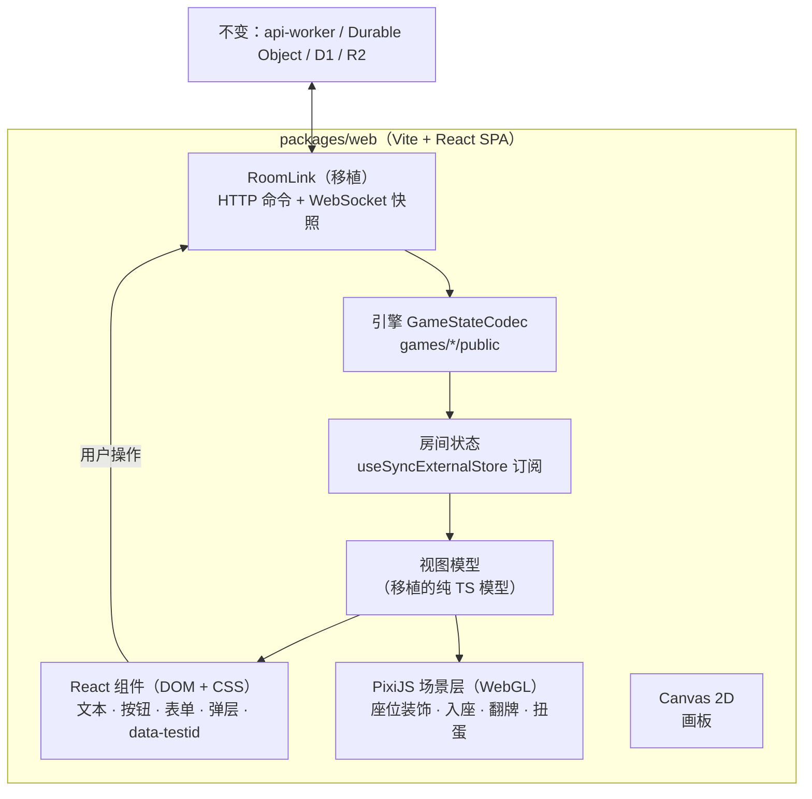

# Web-only 客户端重写方案

> 状态：**设计稿 v3，D0–D8 全部已定**（见 §12）。P0 结束时按实测结果做继续 / 停止判断。
> 基线：2026-11-08，`main` 的 `e1a90a96`（生产 CDN 版本 `0.0.0-ge1a90a96`）。文中的版本号、下载量、体积都是当天查询或实测的结果。
> 范围：用 `packages/web`（React + Vite，只做网页）替换根目录的 React Native / Expo 客户端（`src/`、`App.tsx`、`index.ts`）。`packages/game-engine`、`packages/api-worker`、实时协议 v2、`miniapp/` 不变。
> 原则：先查证再下结论；采用 2026 年社区主流做法，不自造框架和基础组件；失败直接进入明确的错误状态并上报，不静默降级，不写防御性兜底。

## 1. 结论

- 客户端只服务微信小程序 web-view，所以去掉 React Native、Expo 和 react-native-web，保留 React，只做网页（D0，§5.4）。React + react-dom 只占现启动包的 2.4%，不是卡的主要原因。
- 界面用 React 19 + 普通网页元素和 CSS，Vite 构建，React Router 管路由；房间里会动的东西（座位装饰、入座动画、翻牌特效、扭蛋机）放进 PixiJS v8（WebGL）场景层（D1，§5.2）。
- 旧客户端每次冷启动，出界面前要下载 2.08 MB 入口 JS 和 3.25 MB CanvasKit WASM（都是 gzip 后的大小），解析约 8.46 MB JS，编译约 8 MB WASM（§3）。新客户端首页预算 ≤ 2000 KiB gzip（除 bench 外的应用代码全部静态导入，Replay 已关闭），没有 WASM（§4）。
- 引擎、后端、协议、数据都不动。约 3.35 万行纯 TS（实时链路、HTTP、鉴权、音频、各游戏模型）和约 1 万行只依赖 React 的 hooks 与组件直接移植；约 10.1 万行依赖 React Native 的界面代码重写（§7）。
- 只开一个分支开发（D4），旧客户端冻结（D5），现有 34 个 Playwright spec 作为对等验收。分支合并回 `main` 就是切换，生产环境始终只有一个客户端。

## 2. 运行环境与约束

### 2.1 目标运行时

| 环境               | 内核                              | 依据                                                           |
| ------------------ | --------------------------------- | -------------------------------------------------------------- |
| iOS 微信           | 系统 WKWebView                    | 微信官方《小程序的运行环境》（2026-08-10 更新）                |
| Android 微信       | 微信 XWeb（基于 Mobile Chromium） | 同上                                                           |
| 鸿蒙微信           | ArkWeb                            | 微信官方 web-view 文档：UA 同时含 `ArkWeb` 和 `MicroMessenger` |
| Windows / Mac 微信 | Chromium / WKWebView              | 运行环境文档；不是重点                                         |
| 桌面 Chromium      | —                                 | 只用于开发和 E2E                                               |

运行环境文档写的是小程序视图层的内核；web-view 页面实际用的内核和版本，以 P0 的 UA 遥测为准。现入口给 iOS < 15.4 补了 `crypto.randomUUID` 和 `Array.prototype.at`（[index.ts](../index.ts)），最低支持版本同样由 P0 遥测确定。

### 2.2 web-view 能力边界（微信官方文档，2026-11-08 查证）

- 网页内只能用 JSSDK 1.3.2：`wx.miniProgram.navigateTo / navigateBack / switchTab / reLaunch / redirectTo / postMessage / getEnv`。
- 其他 JSSDK 只开放图像（`chooseImage`、`previewImage`、`uploadImage`、`downloadImage`、`getLocalImgData`）、`getNetworkType`、位置和 `scanQRCode`。录音与语音播放不可用，音频继续走 Web Audio。
- 前台状态：`WeixinJSBridge.on('onPageStateChange', …)`（微信 7.0.3+）。它和 `visibilitychange` 一起控制渲染与音频的暂停。
- 网页里的 iframe 域名也要配置业务域名；每个小程序页面只能有一个 web-view。
- 震动：iOS 的 WKWebView 不支持 `navigator.vibrate`，Android WebView 支持（MDN 兼容表）。

### 2.3 不变、放弃与不做

- 不变：引擎（4.15 万行）、Worker（2.0 万行）、协议 v2 与关闭码、DO / D1 / R2、Pages Function 的房间 OG 改写（`functions/room/[roomCode].ts`）、npmmirror CDN 发布链路、[小程序壳](../miniapp/pages/index/index.js)与 `wechat-claim` nonce 登录。
- 放弃：iOS / Android 原生构建、PWA 安装引导、`*.web.ts` 平台分叉。
- 不做：引擎规则、协议、数据库变更；生产环境双客户端并行或运行时回退到旧客户端；重写期间的新功能（D5）。

## 3. 现状事实

| 项          | 事实                                                                                                                                                                                                              | 来源                                                            |
| ----------- | ----------------------------------------------------------------------------------------------------------------------------------------------------------------------------------------------------------------- | --------------------------------------------------------------- |
| 启动顺序    | Web 入口先 `await LoadSkiaWeb()`（下载、解压并实例化 CanvasKit WASM），完成后才 `require('./App')`                                                                                                                | [index.ts](../index.ts)                                         |
| 入口 JS     | 生产 `index-5f658738….js`：8,460,150 字节，gzip 后 2,083,744 字节；CDN 返回 `Cache-Control: max-age=86400`                                                                                                        | 2026-11-08 实测生产 CDN                                         |
| 启动包构成  | 应用代码 37.3%；Reanimated + worklets + gesture-handler 10.1%；Sentry 7.0%；拼音库 pinyin-pro 5.7%（只有瞎掰王用）；Skia JS 4.5%；react-native-web 3.3%；React + react-dom 2.4%；html2canvas 2.4%（只在分享时用） | 本地构建的入口包按源码映射统计                                  |
| WASM        | `canvaskit.wasm.gz` 3,246,373 字节（解压后约 8 MB）                                                                                                                                                               | 同上；[ci.yml](../.github/workflows/ci.yml) 的发布步骤          |
| Skia 使用面 | 24 个生产文件：翻牌特效（14 种中 11 种直接用 Skia）与阵营通用特效、画板、扭蛋机、着色器预热                                                                                                                       | `@shopify/react-native-skia` 引用                               |
| 常驻装饰    | 已迁到 CSS `@keyframes`：312 个动画节点的主线程占用从 49% 降到 16%，剩余成本是 Blink 在每个迭代边界的记账                                                                                                         | [loop-motion-design.md](archive/loop-motion-design.md) §7       |
| 动画线程    | Reanimated 在 web 没有 UI 线程，shared value 动画在主线程逐帧执行                                                                                                                                                 | [loop-motion-design.md](archive/loop-motion-design.md) §1       |
| 客户端规模  | 非测试代码约 14.4 万行：纯 TS 3.35 万行，只依赖 React 0.99 万行，依赖 React Native 10.1 万行（§7）                                                                                                                | 2026-11-08 统计                                                 |
| E2E         | 34 个 spec、1.54 万行；`getByTestId` 454 处，`TESTIDS` 来自 [src/testids.ts](../src/testids.ts)                                                                                                                   | `e2e/`                                                          |
| 错误上报    | `Sentry.init` 在 `App.tsx` 里执行，而入口要等 CanvasKit 加载完才 `require('./App')`，这之前的启动失败不会上报                                                                                                     | [index.ts](../index.ts)、[App.tsx](../App.tsx)                  |
| 分享图      | 复盘导出用 html2canvas 截取同一个复盘文档组件（"一个渲染器"）；html2canvas 最新版 1.4.1 发布于 2022-01-22，之后没有新版本                                                                                         | [game-review-share-design.md](game-review-share-design.md)；npm |
| 未知        | 真机微信内的帧时间、点击延迟、内存                                                                                                                                                                                | P0 测量                                                         |

## 4. 目标与预算

### 4.1 体积（CI 强制）

| 分块                     | 预算（gzip） | 依据                                                                                                                                                                 |
| ------------------------ | ------------ | -------------------------------------------------------------------------------------------------------------------------------------------------------------------- |
| 首页入口（到首页可交互） | ≤ 2000 KiB   | 应用代码全部静态导入，只有 bench 内容按需下载（§5.10）；2026-11-13 加入外部投稿后台后实测约 1407 KiB（原分支 1388 KiB）；产品确认保留静态加载并将上限调整到 2000 KiB |
| Session Replay           | 已关闭       | 移除回放采集，避免持续消耗 Sentry Replay 配额                                                                                                                        |
| WASM、Web 字体           | 0            | 去掉 CanvasKit；图标在构建期内联为 SVG                                                                                                                               |

进入任何游戏不再额外下载应用代码；图片、音频等媒体仍按使用场景请求，不计入 JS/CSS gzip 预算。CDN 能减少传输延迟，但不会消除首次下载、解压和 JavaScript 解析成本。

### 4.2 运行时（社区标准阈值 + P0 实测基线）

- 交互响应：INP p75 ≤ 200 ms（web.dev 的"良好"阈值）。Sentry SDK 11 的 BrowserTracing 自动采集 INP、LCP、CLS，不另建上报。
- 长任务：应用快照、切换页面、处理点击都不产生超过 50 ms 的任务（web.dev 对长任务的定义）。
- 场景层帧时间：p95 不超过所选帧率的一帧（默认 60 fps，即 16.7 ms；帧率见 D3）。
- 房间空闲主线程占用：不超过 P0 实测的现状基线的 1/3。
- 页面不可见或装饰关闭时，场景层不出帧。
- 纹理随最后一个使用者销毁，离开房间即释放（§5.3）；驻留上限在 P0 的 iOS 真机实测后写入本节。

### 4.3 启动时间

- 基线来自现有 `load_timing` 数据集（[telemetry/routes.ts](../packages/api-worker/src/platform/telemetry/routes.ts)）：`double9` 是 `boot:start → app:registered`，`blob2` 是 UA。P0 按 iOS、Android、鸿蒙分桶，用 `_sample_interval` 加权算 p50 / p75 / p95。
- 新客户端上报同名标记，并新增 `app:interactive`（首页可点击）。拿到基线后，把目标值写进本节。

## 5. 架构

### 5.1 分层与数据流

### 5.2 界面不进 WebGL 的理由（D1）

- PixiJS 自己的做法：输入框用 `DOMContainer` 把 HTML 元素叠在画布上（v8 中仍标为实验性）；无障碍用 `AccessibilitySystem` 在画布上叠不可见的 DOM `
`。全画布应用最后仍要靠 DOM 处理输入和无障碍。
- 文本：`Text` 和 `HTMLText` 每次改动都要重绘到画布、再上传 GPU；`BitmapText` 只能用预生成的字形集，而且只在原生字号下像素精确（PixiJS v8.22 文档）。昵称、聊天这类中文内容无法预知，大量文字进画布既占显存又难排版。
- 屏幕阅读器读不到画布；E2E 里 454 处 `getByTestId` 都依赖 DOM，界面进画布后 1.54 万行 E2E 都要重写。
- 动作类网页游戏几乎没有表单和长文本，才适合全画布。本产品大部分屏幕是文字和表单，所以 DOM 管界面、WebGL 管会动的画面；界面动效走 CSS / Web Animations（§5.4），同样不占主线程。

### 5.3 场景层（PixiJS v8）

- 全局只有一个 `Application`（只占一个 WebGL 上下文），首次进入房间、扭蛋或外观页时懒加载。
- React 只负责挂载画布，把座位位置和装饰配置传给场景模块（React 文档里"用 Effect 同步外部系统"的做法）。场景每帧的更新不经过 React 渲染，所以不用把场景树交给 React 管理的 `@pixi/react`。
- WebGL 是硬性前提：初始化失败直接进入错误页并上报 Sentry，不降级成"没有特效"继续运行。素材加载失败同样直接抛错，不留下缺一块装饰的半成品画面。
- 用 `autoStart: false`，由场景调度器驱动：有动画才渲染，静止时不出帧；`ticker.maxFPS` 取用户设置（D3：60 或 30，默认 60）；`document.hidden` 或 `onPageStateChange` 报告不活跃时停帧。
- 渲染分辨率取 `min(devicePixelRatio, 2)`，开启 `autoDensity`。
- 不打图集：装饰的矢量几何按「绘制源 + 尺寸」共享 `GraphicsContext`；静态 SVG 按 `(art, 尺寸, 分辨率)` 光栅化成纹理共享；粒子是共用一张白色圆点纹理、靠 tint 和缩放区分的普通 `Sprite`（`scene/stage.ts`）。同尺寸同装饰的座位共用同一份几何和纹理。
- 几何和纹理都引用计数，最后一个使用者卸载时销毁（纹理 `destroy(true)` 同时释放显存），所以离开房间就释放；不经 `Assets` 加载，也就不需要 `Assets.unload`。WebGL 上下文丢失后，渲染器会在 `webglcontextrestored` 时自行恢复（v8.22 文档）；切后台和锁屏后的表现在 P0 真机上验证。
- 和 DOM 对齐：座位的语义（`data-testid`、无障碍名称、文本、点击）留在 DOM；场景层用 `ResizeObserver` 读取座位矩形来摆放精灵；画布设 `pointer-events: none` 和 `aria-hidden="true"`。
- 层级方案在 P0 spike 中二选一：
  - A：头像也画进场景层，层级完全可控，但图片要带 CORS 头才能作为 WebGL 纹理（R2 头像和 CDN 资源都要确认；分享截图也有同样的要求，见 §5.8）。
  - B：场景层整体盖在 DOM 头像之上，原来在头像后面的效果改为环绕头像并遮罩头像区域。
- 运动来源：直接复用 loopMotion 的 sampler（`(t, size) => geometry` 纯函数），每帧驱动精灵变换，不再编译 CSS keyframes。
- 翻牌特效同时有 Pixi 画面和 DOM（卡面、文字、按钮），两者用同一个时钟：舞台 ticker 每帧推进 `RevealScene`，共享值、Pixi 重绘和 DOM 的 `transform` / `opacity` 写入都读这一帧的时间（`RoleRevealEffects/runtime.ts`）。不用 Web Animations，因为 WAAPI 的文档时间线和 Pixi ticker 是两个时钟，卡面会和画布特效错帧；单一时钟也让假时钟能逐帧驱动截图。代价是这些 DOM 写入在主线程执行，所以只写合成属性（`transform`、`opacity`），不触发布局。每块画面由挂载它的 Effect 创建图层并在卸载时销毁（`useFrameArt`）。
- 系统 reduced-motion 开启或"座位装饰"开关关闭时，不创建常驻装饰。

### 5.4 界面框架（D0，已定）

用 React，只做网页（方案 B）：React 19 + 普通网页元素和 CSS，不再经过 React Native。依据：

- React 不是卡的主要原因：React + react-dom 只占现启动包的 2.4%（§3）。卡来自 React Native 搬到网页上的那几层：react-native-web（3.3%）、Reanimated 一套（10.1%，动画在主线程逐帧计算）、Skia（JS 4.5%，另加 3.25 MB WASM）。
- React 仍是用得最多的前端框架（State of JS 2025；`react` npm 周下载 2.53 亿）。
- 约 1 万行只依赖 React 的 hooks 和组件可以直接沿用。

技术栈（2026-11-08 核实的版本）：

| 用途       | 选择                                                                    | 依据                                                                                                                         |
| ---------- | ----------------------------------------------------------------------- | ---------------------------------------------------------------------------------------------------------------------------- |
| 界面       | React 19.3.1、react-dom 19.3.1                                          | 现用 19.2.3，小版本升级                                                                                                      |
| 构建       | Vite 8.3.6 + `@vitejs/plugin-react` 6.2.1                               | react.dev《从零搭建 React 应用》用 Vite                                                                                      |
| 自动优化   | React Compiler 1.0（`babel-plugin-react-compiler`，仓库已在用）         | 按 react.dev 给出的 Vite 配置（`@rolldown/plugin-babel` + `reactCompilerPreset()`）；示例应用实测编译生效                    |
| 路由       | React Router 8.5.1，数据模式（`createBrowserRouter`，路由页面静态导入） | 见下文                                                                                                                       |
| 服务端数据 | TanStack Query 5（`@tanstack/react-query`，已在用）                     | §5.5                                                                                                                         |
| 交互组件   | Ark UI React 5.40.0：对话框、抽屉、滑块、取色器、二维码、标签页         | 一个库覆盖全部需要的组件。Radix 的下载量更大（`@radix-ui/react-dialog` 周下载 9271 万），但 npm 上没有它的取色器和二维码组件 |
| Toast      | sonner 2.0.8（周下载 5718 万）                                          | 现用的 sonner-native 就是它的 React Native 移植版                                                                            |
| 测试       | Vitest + `@testing-library/react` 16.3.3                                | §9                                                                                                                           |

路由为什么用数据模式：react.dev 推荐整站应用用框架（Next.js、React Router 框架模式）。但实测 React Router 8 的框架模式（SPA 模式）下，只要把 Vite 的 `base` 设成 npmmirror 的绝对地址，构建就会在预渲染 `index.html` 时失败（返回 302）；去掉 `base` 就能构建成功。同一个示例改用普通 Vite + React Router 数据模式，带同样的 `base` 也能构建成功，生成的 `index.html` 直接引用 CDN 地址。资源必须走国内 CDN，所以用数据模式。react.dev 对这种情况的说法是：现有框架不适合应用的约束时，可以从零搭建。

约定：

- 房间状态这类外部数据源，用 React 官方的 `useSyncExternalStore` 订阅。
- React 默认转义文本；禁止 `dangerouslySetInnerHTML`，由 ESLint 的 `react/no-danger` 强制。
- 界面动效只用 CSS，只改 `transform` 和 `opacity`；按压反馈用 `:active`。弹层的进出场用 Ark UI 的 presence（`data-state` 配 CSS 动画，关闭动画结束后才卸载）。
- 渲染出错由 Sentry 的 React `ErrorBoundary` 接住，显示错误页并上报。
- 路由路径和现在一致（包括 `/room/:code` 深链）；Pages 的房间 OG 改写不变。

### 5.5 状态与数据流

- RoomLink 从 `src/platform/realtime/` 移植。该目录只有 `PlatformEnvironment.ts` 依赖 RN。命令走 HTTP `POST /room/command`，按 `commandId` 关联；WebSocket 接收 `SYNC_RESULT`、`STATE_UPDATE`、`INBOX_HINT`。
- 快照经引擎 `GameStateCodec` 解码后整块替换房间状态，组件用 `useSyncExternalStore` 订阅；视图模型直接复用各游戏现有的纯 TS 模型、策略和引导矩阵（`src/games/*/model`、`policy` 等），计算结果由 React Compiler 自动缓存。
- 解码失败（例如状态版本不受支持）由引擎抛错，房间进入错误状态并上报，不尝试兼容。
- 服务端数据（用户统计、解锁等）继续用 TanStack Query（query-core 实测 10 KB gzip）。现在查询失败会重试两层：`ApiClient` 对幂等请求的网络错误重试，`src/app/queryClient.ts` 里 Query 层再重试 2 次。新客户端只保留 `ApiClient` 这一层，Query 层设 `retry: false`。

### 5.6 移植的平台模块

| 现模块                                           | 处置                                                                                          |
| ------------------------------------------------ | --------------------------------------------------------------------------------------------- |
| `src/platform/http`、`auth`、`inbox`、`realtime` | 连同测试原样移植；`env/PlatformEnvironment.ts` 改用 `visibilitychange` 和 `onPageStateChange` |
| `src/services/infra/audio/*`                     | 移植 Web Audio 部分（含 `webAudioUnlock`、`BgmPlayer`），删除 `NativeAudioStrategy`           |
| `src/services/cloudflare/*`                      | 移植鉴权、房间目录、头像上传和响应编解码                                                      |
| `src/utils/miniProgram.ts`                       | 移植环境判断和带 nonce 的 `reLaunch` 重登                                                     |
| [web/index.html](../web/index.html) 内联脚本     | 移植微信环境判断、浏览器引导页、JSSDK 加载和"隐藏 5 分钟后重载"                               |
| 存储（MMKV）                                     | `localStorage`                                                                                |
| 日志（`react-native-logs`）                      | 保留现有具名 logger 接口，底层改为 `console` + Sentry breadcrumbs；保留 `no-console` 规则     |

### 5.7 依赖替换

| 现依赖                                                                                | 新方案                                                                                                        |
| ------------------------------------------------------------------------------------- | ------------------------------------------------------------------------------------------------------------- |
| `react-native`、`react-native-web`、`expo`、`expo-*`、`react-native-screens`          | 删除；界面改用网页元素 + CSS                                                                                  |
| `react`、`react-dom`                                                                  | 保留，升到 19.3                                                                                               |
| `@react-navigation/*`                                                                 | React Router 8（数据模式）                                                                                    |
| `react-native-safe-area-context`                                                      | CSS `env(safe-area-inset-*)`                                                                                  |
| `react-native-reanimated`、`react-native-worklets`、`react-native-gesture-handler`    | CSS 动画（只改 `transform` 和 `opacity`）、Pointer Events；弹层进出场用 Ark UI 的 presence；场景动画进 PixiJS |
| `react-native-svg`                                                                    | 静态 SVG；动态图形进 PixiJS                                                                                   |
| `@shopify/react-native-skia`（CanvasKit）                                             | 特效改用 PixiJS；画板改用 Canvas 2D                                                                           |
| `@expo/vector-icons`（Ionicons 字体）                                                 | `unplugin-icons` + `@iconify-json/ion`，构建期内联，只打包用到的图标（D2）                                    |
| `expo-image`                                                                          | `` + WebP                                                                               |
| `expo-image-picker`                                                                   | `<input type="file" accept="image/*">` + Canvas 缩放压缩                                                      |
| `expo-audio`                                                                          | 移植的 Web Audio 策略（§5.6）                                                                                 |
| `expo-haptics`                                                                        | Android 用 `navigator.vibrate`；iOS 没有对应能力（§2.2）                                                      |
| `react-native-view-shot`、`html2canvas`                                               | SnapDOM（§5.8，D7）                                                                                           |
| `react-native-qrcode-svg`                                                             | Ark UI QR Code                                                                                                |
| `sonner-native`                                                                       | sonner（网页版）                                                                                              |
| `reanimated-color-picker`                                                             | Ark UI Color Picker                                                                                           |
| `react-native-awesome-slider`                                                         | Ark UI Slider                                                                                                 |
| `@tanstack/react-query`                                                               | 保留（§5.5）                                                                                                  |
| `@sentry/react-native`                                                                | `@sentry/react`（§5.9，D8）                                                                                   |
| `pinyin-pro`                                                                          | 只在瞎掰王房间分块里懒加载                                                                                    |
| `zod`、`ua-parser-js`                                                                 | 保留（引擎依赖；遥测分组）                                                                                    |
| `@welldone-software/why-did-you-render`、`jest-expo`、`@testing-library/react-native` | 删除                                                                                                          |

### 5.8 分享图（D7）

- 保持已实施的"一个渲染器"设计（[game-review-share-design.md](game-review-share-design.md) §2.1）：房内视图和导出图来自同一个复盘文档组件，只换截图库。
- 截图库用 SnapDOM（`@zumer/snapdom` 3.7.2，2026-11-08 发布）。它的 README 写明过去一年约每周发布一次，测试覆盖 Chromium、Firefox 和 WebKit。
- SnapDOM 导出长图时分窗口渲染，绕开画布尺寸上限（Safari 单边 16,384 px）。现在小程序专用的分带截图分支能否删掉，P3 在 iOS 微信真机上验证后决定。
- 跨域图片（头像、画作）必须带 CORS 头才能截进图里，和场景层方案 A 的要求相同，P0 一并确认。
- 分发链路不变：上传 `/share/image`，再调 `wx.previewImage`。

### 5.9 错误上报与监控（D8）

- 继续用 Sentry，SDK 从现装的 10.53.1 升到 11.x（`@sentry/react` 11.11.0）。
- 按 Sentry 官方做法，把初始化放在入口的第一行。现客户端要等 CanvasKit 加载完才初始化，启动期的失败会漏报，这次一并修正。
- 启动时只装错误监控和 BrowserTracing（实测 46 KB gzip；SDK 11 的 BrowserTracing 自动采集 INP、LCP、CLS）。Session Replay 已移除，不录制会话，也不消耗 Replay 配额。
- traces 采样率为 0.2。
- P0 在 Sentry 后台核对来自微信客户端的事件确实能到达。
- `load_timing` 遥测保留，用于按运营商和 CDN 节点分析加载耗时，这是 Sentry 不覆盖的维度。

### 5.10 构建、部署与缓存

- Vite 8.3.6 + `@vitejs/plugin-react` 6.2.1（Vitest 4.1.10 的 peer 允许 `^8`）。P0 同时确认 `@cloudflare/vitest-pool-workers` 能否和根目录一起升到 Vite 8。
- 引擎从 TS 源码引入（别名到 `packages/game-engine/src`），因为它 `exports` 的 `default` 指向 CJS `dist`，不利于 tree-shaking。
- 文件名按内容哈希，CDN 上设 `immutable` 长缓存。现在 Metro 按源码哈希命名，[web/\_headers](../web/_headers) 只能给 `/assets/js/*` 设 `no-cache`。
- Vite 的 `base` 设为 npmmirror 的版本化地址，代替 CI 里对 JS 和 HTML 的 `sed` 改写（示例应用实测：构建出的 `index.html` 直接引用 CDN 地址）；删除 CanvasKit WASM 的发布步骤。HTML 仍由 Cloudflare Pages 发出（`no-cache`），SPA 回退沿用现有的 `_redirects`。
- 应用代码全部静态导入，包括所有路由、游戏模块、PixiJS、装饰、翻牌特效、截图和弹窗；只有开发基准页（`/__bench/scene`）内容保持独立异步分块。Replay 已关闭并移除。动态导入位置由 AST 契约固定，构建检查禁止新增应用懒加载入口，也禁止 bench 混入首页静态闭包。PixiJS 自带的未使用 Web Worker 环境分块不是应用入口，浏览器场景不请求它。
- 代码预先下载不等于立即运行功能：游戏 session、WebSocket、音频服务、WebGL、纹理和弹窗仍按原生命周期创建或挂载；保留等待真实资源的 Suspense。图片和音频仍是独立媒体请求，角色立绘按公开配置在房间里低优先级预取并解码。
- 角色立绘在房间就绪后按公开板子/配置低优先级预加载并调用 `Image.decode()`（狼人杀、阿瓦隆、谁是卧底、瞎掰王），不根据玩家隐藏身份选择请求。共享 `useRolePortraitPreload` 对重复角色和快照更新去重；失败记录日志、不阻塞翻牌，卡片仍可正常请求图片。其他游戏没有角色立绘，不做额外预加载；慢网下不保证图片一定先于翻牌完成。
- 自己的启动逻辑（微信环境判断、浏览器引导页、JSSDK 加载）放进入口模块，不写内联脚本。
- 构建目标显式配置，取值由 P0 遥测决定。
- CI：`packages/web` 接入 Turbo 的 typecheck、lint、test、build 和体积检查。合并时，`deploy-frontend` 从 `scripts/build.sh`（`expo export`）改为 `pnpm --filter @game-judge/web build`。
- 分支预览：部署到一个在小程序后台登记过的业务域名（新增子域时沿用现有的校验文件函数），在真机上用小程序壳已支持的 `?url=` 参数打开。

### 5.11 安全与无障碍

- 不可信字符串只经 React 默认转义输出，禁止 `dangerouslySetInnerHTML`（§5.4）。`_headers` 增加 CSP，`script-src` 只放行自站、CDN 和 `res.wx.qq.com`；Vite 构建出的 `index.html` 只有外链脚本（示例应用实测），不需要内联脚本哈希。
- 鉴权令牌的存取语义照搬 `src/platform/auth`。
- 交互元素用原生 `<button>`、`<input>`、`<label>`；对话框、抽屉等组件的焦点陷阱和键盘交互由 Ark UI 负责；toast 和状态条使用 `aria-live`；颜色只用 token 以保证对比度；遵循 `prefers-reduced-motion`；画布设 `aria-hidden`。
- token 以 CSS 自定义属性为唯一来源（`packages/web/src/theme/tokens.css`，从 `src/theme/tokens.ts` 和 `colors.ts` 移植），组件 CSS 只引用变量；现有"禁止硬编码样式值"的契约改为检查 CSS 和 TSX。

## 6. 视觉资产与特效

| 类别                         | 现规模                     | 现实现                     | 新实现                                                                      |
| ---------------------------- | -------------------------- | -------------------------- | --------------------------------------------------------------------------- |
| 头像框 `avatarFrames`        | 71 个组件，1.04 万行       | SVG + loopMotion keyframes | 静态层是共享矢量几何或按尺寸光栅化的 SVG 纹理，sampler 驱动动态部分（§5.3） |
| 座位光效 `seatFlairs`        | 78 个组件，7,540 行        | 同上                       | 同上，粒子是共用圆点纹理的 `Sprite`                                         |
| 入座动画 `seatAnimations`    | 38 个组件，5,022 行        | Reanimated + SVG           | PixiJS 时间线                                                               |
| 宠物 `seatPets`              | 15 个组件，1,934 行        | SVG + loopMotion           | 光栅化纹理 + sampler                                                        |
| 名字样式 `nameStyles`        | 1 个数据驱动组件，1,285 行 | RN 文本样式                | 留在 DOM，用 CSS 实现                                                       |
| 翻牌特效 `RoleRevealEffects` | 14 种 + 阵营通用特效       | 主要是 Skia                | PixiJS + DOM，同一时钟（§5.3）                                              |
| 扭蛋机 `CapsuleMachine`      | 1                          | Skia                       | PixiJS                                                                      |
| 画板 `DrawingCanvas`         | 1                          | Skia                       | Canvas 2D（`toBlob` 导出 PNG）                                              |

管线：

1. P1 删除旧客户端之前，用一次性脚本在 Playwright 里逐个渲染装饰的静态层并导出（透明背景截图或 SVG 序列化），作为图集源图，同时保存新旧对比用的基准截图。
2. 动态部分由现有 sampler 驱动精灵。
3. 每一批装饰在固定时刻 `t` 做新旧并排截图，交你验收（D6：效果一致，细节可以不同）。

## 7. 移植清单

按文件的导入统计（2026-11-08，单位：行）。"纯 TS"不导入 React 或 React Native；"只依赖 React"导入了 `react`、`react-dom` 或 `@tanstack/react-query`，但没有导入 React Native 及其生态库。

| 目录                                                                              | 纯 TS  | 只依赖 React | 依赖 React Native | 处置                                                              |
| --------------------------------------------------------------------------------- | ------ | ------------ | ----------------- | ----------------------------------------------------------------- |
| `src/platform`                                                                    | 2,811  | 0            | 213               | 移植；改写 `PlatformEnvironment`                                  |
| `src/services`                                                                    | 1,160  | 0            | 1,305             | 移植音频与 Cloudflare 服务，其余重写                              |
| `src/games`                                                                       | 17,279 | 4,517        | 21,515            | 移植模型、策略、音频注册表、复盘和只依赖 React 的 hooks；重写界面 |
| `src/features`                                                                    | 8,002  | 3,140        | 28,517            | 其中 `room` 约 3.34 万行；移植纯 TS 和 hooks，其余重写            |
| `src/components`                                                                  | 1,376  | 1,893        | 30,104            | 装饰约 2.7 万行走 §6 管线，其余重写                               |
| `src/screens`                                                                     | 471    | 49           | 17,155            | 重写                                                              |
| `src/theme`                                                                       | 234    | 0            | 664               | 生成 CSS 自定义属性                                               |
| 其余（`utils`、`config`、`types`、`testids.ts`、`app`、`contexts`、`navigation`） | 2,175  | 289          | 1,534             | 移植纯 TS 和 context；导航重写                                    |
| 合计                                                                              | 33,508 | 9,888        | 101,007           |                                                                   |

## 8. 迁移策略与阶段

### 8.1 原则

- 只开一个分支 `refactor/web-only-client`（已建，基于 `e1a90a96`）。`main` 继续承载生产上的旧客户端，只修线上 bug（D5）。
- 定期把 `main` 合并进分支（不 rebase，不强推）。`main` 上的修复如果落在已经重写的区域，在分支上按新客户端重做。
- 分支合并回 `main` 就是切换：同一次合并删除旧客户端、修改部署任务，生产环境不会同时存在两个客户端。
- 回滚只用于止血：把 Cloudflare Pages 回滚到上一个部署（旧资源仍在 npmmirror 上），问题在新客户端修好后重新发布。
- 现有 E2E 是对等标准：新客户端保留 `TESTIDS`、可访问名称和文案。分支 CI 只跑"已迁移 spec 清单"，清单只增不减；合并前清单必须覆盖全部 34 个 spec，然后删除清单本身。
- 每个阶段独立验收：该阶段的 spec 全绿，满足 §4.1 体积预算，单测通过。

### 8.2 阶段

**P0 基线与技术验证**（旧客户端仍在分支上；结束时做继续 / 停止判断）

- 基线：从 `load_timing` 取分平台启动时间；在 iOS、中低端 Android、鸿蒙真机的微信里测现客户端的启动时间、INP、房间空闲主线程占用和翻牌特效帧时间。
- 用遥测里的 UA 分布确定构建目标和最低支持版本。
- Spike（Vite + React + PixiJS）：12 个 DOM 座位 + 场景层（移植 3 个最重的光效、1 个头像框、1 个宠物、1 个翻牌特效），在同一批真机上对比；同时确定 §5.3 的层级方案、图片 CORS，以及 SnapDOM 在 iOS 微信里的截图效果。
- 确定分支预览的业务域名和真机打开方式（§5.10）。
- 继续条件：房间空闲主线程占用不超过基线的 1/3；场景层 p95 帧时间不超过 16.7 ms；INP p75 ≤ 200 ms；切后台和锁屏恢复后一切正常。

**P1 拆除旧客户端 + 平台层 + 应用壳**

1. 从旧客户端导出装饰图集源图和对比基准截图（§6）。
2. 把 `src/__tests__` 的 32 个契约逐个分类：跨包的（如 `architecture.contract.test.ts` 的 D1 表归属和 Worker 文件清单、`ciE2eCoverage`、`workerDeployConfig`）迁到根目录单独的 Vitest 项目并保持通过；RN 专属的删除；客户端规则按新技术栈重写。
3. 删除 `src/`、`App.tsx`、`index.ts`、`app.json`、Metro / Babel / Jest 配置、`__mocks__/`、RN 依赖和 `scripts/build.sh` 中的 Expo 步骤。新游戏生成器在 P2 之前只生成引擎和 Worker 部分。
4. 同一步更新 AGENTS.md 和各 skill 中指向旧客户端的内容，`pnpm run validate:agents` 必须通过。
5. `src/testids.ts` 迁入 `packages/web`，E2E 改从这里引入。
6. 移植平台层；搭应用壳和基础组件；做登录、首页、选游戏、设置（含 D3 的帧率选项）。

验收：`app-home`、`app-entry-flow`。

**P2 房间壳 + Demo + 生成器**

- 座位盘、底部操作区、状态条、分享二维码、引导、机器人接管、阶段倒计时、音频编排；Demo 全流程。
- 生成器的客户端模板改以新 Demo 为参照，恢复 Demo 一致性契约。
- 验收：`app-room-lifecycle`、5 个 `resilience-*` 和生成器契约。

**P3 场景层 + 狼人杀**

- 场景层正式版、装饰管线、翻牌特效、入座动画；狼人杀全部界面（夜晚流程、警长竞选、笔记、AI 聊天、复盘分享、旁白音频）。
- 验收：17 个 `werewolf-*` 和 `room-narration`。

**P4 其他游戏 + 产品页**

- 阿瓦隆、谁是卧底、瞎掰王、故事接龙、你画我猜接龙、经典你画我猜（Canvas 2D 画板）。
- 外观、扭蛋、解锁、碎片兑换、音乐设置、图鉴、反馈、管理后台。
- 验收：`avalon`、`undercover`、`fibking`、`fibking-responsive`、`storyrelay`、`pictionary`、`drawguess`。产品页的 E2E 覆盖在 P4 开始前核对，缺口用单测和手工清单补上。

**P5 真机验收与合并**

- 真机清单：nonce 登录、从 `/room/:code` 分享链接进入、音频解锁与旁白、切后台与锁屏、图片预览分享、画板上传、连续玩 1 小时的发热和内存。
- 对照 §4 的预算和 P0 基线。
- 合并前：已迁移清单覆盖全部 spec 后删除清单；`deploy-frontend` 改为构建 `packages/web`；`docs/` 中描述旧客户端的文档移入归档。
- 合并即切换，之后观察 Sentry 和 `load_timing`。

## 9. 测试与验收

- 单测：Vitest。组件和 hooks 测试用 `@testing-library/react`（现有测试里的 `renderHook` 写法可以沿用）；移植的纯模块连同现有 Jest 测试一起迁到 Vitest；视图模型。
- E2E：页面对象如果依赖 RN-web 的 DOM 细节（例如头像用背景图绘制），改成语义选择器，不在测试里按客户端分叉。
- 性能：一个 Playwright 性能 spec（用 CDP 聚焦模拟避免后台节流）测房间空闲主线程占用和场景层帧时间，作为桌面上的相对回归门禁；绝对预算只在真机上判定，线上 INP 看 Sentry。
- 体积：CI 按入口和路由分块检查 gzip 预算。
- 只测明确需求和已知回归点，不为理论风险堆测试。

## 10. 风险与对策

| 风险                                                   | 对策                                                                                             |
| ------------------------------------------------------ | ------------------------------------------------------------------------------------------------ |
| 约 10.1 万行 React Native 界面代码重写，对等的尾巴拖长 | 纵向切片；E2E 对等；功能冻结（D5）；P0 继续 / 停止判断                                           |
| React Router 框架模式不支持跨域 CDN 资源（实测）       | 用数据模式（实测可行）；CI 每次都带 CDN `base` 构建，升级后不兼容会直接构建失败                  |
| web-view 里 WebGL 上下文丢失、显存紧张（尤其 iOS）     | 纹理按场景加载、离开即卸载；P0 真机验证切后台和锁屏                                              |
| SnapDOM 在 WKWebView 中的截图效果                      | P0 真机验证；跨域图片的 CORS 与场景层一并确认                                                    |
| 200 多个装饰和特效的视觉对等                           | 导出管线 + 并排截图，按 D6 分批验收                                                              |
| iOS 音频解锁与自动播放                                 | 移植现有 `webAudioUnlock`；真机清单覆盖                                                          |
| 老版本 WebView 缺 API                                  | 构建目标和最低版本由遥测决定；启动时检查必需能力（如 WebGL），不满足就显示"请升级微信"页面并上报 |
| 分支期间 `main` 上的修复                               | 定期把 `main` 合并进分支；已重写区域在分支上按新客户端重做                                       |

## 11. 现有原型

- 早期用自研界面运行时搭过一个原型（alien-signals + 自写 DOM 工具和路由），D0 定为 React 后已从分支上整体删除，没有保留任何代码。
- P0 在 `packages/web` 按 §5.4 的技术栈重新搭建。

## 12. 决定

| 编号 | 问题       | 状态 | 结论                                                                                                                                        |
| ---- | ---------- | ---- | ------------------------------------------------------------------------------------------------------------------------------------------- |
| D0   | 界面框架   | 已定 | React + 网页元素和 CSS + PixiJS，只做网页（方案 B，§5.4）                                                                                   |
| D1   | 渲染分层   | 已定 | DOM + CSS 做界面，PixiJS 做场景层（§5.2）                                                                                                   |
| D2   | 图标       | 已定 | 保留 Ionicons 外观，用 `unplugin-icons` + `@iconify-json/ion` 在构建期内联（已核实：代码里用到的 194 个 Ionicons 名称在该图标集里全部存在） |
| D3   | 场景层帧率 | 已定 | 设置里可选 60 或 30，默认 60                                                                                                                |
| D4   | 分支       | 已定 | 只开一个分支，合并即切换（§8.1）                                                                                                            |
| D5   | 功能冻结   | 已定 | 重写期间旧客户端只修线上 bug，不加功能和新游戏                                                                                              |
| D6   | 视觉对等   | 已定 | 效果一致，细节可以不同；分批并排截图验收                                                                                                    |
| D7   | 分享图     | 已定 | 保持"一个渲染器"，截图库换成 SnapDOM（§5.8）                                                                                                |
| D8   | 错误上报   | 已定 | 继续用 Sentry（`@sentry/react`）：入口第一行初始化；关闭 Session Replay 以避免消耗配额                                                      |

## 13. 修订记录

v2（2026-11-08）：按"先查证、按社区做法、fail fast、不打补丁、不做防御性编程"复核 v1，改了以下内容。

- v1 自研界面运行时，以及自研 toast、取色器、二维码和数据缓存，改为 Svelte 5 + SvelteKit、Ark UI 和 TanStack Query（新增 D0）。
- v1 运行时预算里的 10%、20 ms、8 ms、100 ms 和"4 张 2048² 图集"没有依据，改为 web.dev 标准阈值和 P0 实测基线。
- v1 首页 150 KB 预算没算 Sentry，按实测构成改为 200 KB。
- v1 的 D7（Canvas 2D 直接画）会多出第二个渲染器，和已实施的"一个渲染器"设计冲突，改为只换截图库。
- v1 的 D8（懒加载 Sentry）与 Sentry 官方"尽早初始化"的做法相反，改为入口第一行初始化、只懒加载 Replay，同时修正现客户端启动期漏报。
- 补充 fail fast：WebGL 初始化失败、素材加载失败、快照解码失败、运行环境不满足，都进入明确的错误状态并上报。
- 按 D4 改为单分支，删掉 v1 的过渡期别名引用和 E2E 双客户端开关，改为 P1 迁移 `TESTIDS`、分支上用只增不减的 E2E 清单。
- Android 内核"XWeb"用微信官方运行环境文档查证；iOS 不支持震动用 MDN 查证。

v3（2026-11-08）：按你的确认改为方案 B。

- D0 从 Svelte 改为 React（只做网页）。实测 React + react-dom 只占现启动包的 2.4%，卡来自 React Native 搬到网页上的几层；保留 React 还能直接沿用约 1 万行 hooks 和组件。
- 生态选择换成 React 版本并逐个核实：React 19.3.1、Vite 8.3.6 + plugin-react 6.2.1、React Compiler 1.0、React Router 8.5.1、Ark UI React 5.40.0、sonner 2.0.8、`@sentry/react` 11.11.0。
- 路由用 React Router 数据模式：实测框架模式配国内 CDN 的绝对 `base` 会构建失败，数据模式可以。
- 首页预算按实测构成从 200 KB 改为 280 KB（React + react-dom + React Router 约 100 KB）。
- 发现现在查询失败会重试两层（`ApiClient` 和 Query），新客户端只保留一层。

实施中的调整（2026-11-08，P0–P1 起步）：

- React 暂留 19.2.3：仓库用 hoisted 安装，根目录的 RN 客户端锁定 19.2.3，`packages/web` 用 19.3 会被嵌套出第二份 React（测试实测报 hooks 错误）。P1 删除 RN 客户端时一起升到 19.3。
- `@sentry/react` 11 已移除 `sendDefaultPii`、`enableLogs`（改为 `dataCollection`，日志默认开启）；路由追踪用 `@sentry/react/react-router` 的 `reactRouterBrowserTracingIntegration` 和 `wrapCreateBrowserRouter`。
- Replay 独立分块实测 51 KB，预算改为 52 KB（§4.1）。
- token 改为以 CSS 自定义属性为唯一来源（§5.11），不做构建期生成。
- 场景层 spike 用层级方案 B（画布盖在 DOM 头像上）；`onPageStateChange` 未在现客户端使用过，先沿用现有的 `visibilitychange` / `pageshow` / `focus`，真机验证后再决定是否接入。
- 整个工作区随 `packages/web` 解析到 Vite 8；引擎和 Worker 的测试（含 `@cloudflare/vitest-pool-workers`）在 Vite 8 下全部通过。

实施中的调整（2026-11-10）：

- 路由不再用 `lazy` 分块，页面全部静态导入（§5.10）：首次进入懒加载的路由要先下载分块，点击后 1–3 秒没反应。首页入口预算按实测 527.2 KB 从 280 KB 改为 550 KB（§4.1）；入口里的模块因此全部用 `zod/mini` 解码。

实施中的调整（2026-11-11）：

- 曾将基准页内容拆开、禁止 PixiJS 进入首屏，入口实测 398.0 KiB；随后产品明确选择除 bench、Replay 外的代码全部预先加载，优先避免后续操作等待下载。现在入口实测约 1340 KiB，预算 1400 KiB；取消旧的独立游戏、场景预算及 PixiJS、classic Zod 首屏禁令，改为检查 bench、Replay 不进入首页和应用动态入口白名单。Vite 单块提示阈值为 4100 kB（入口实测约 3920 kB minified），gzip 门禁仍独立执行。
- 同日合入 main 的 Replay 关闭改动后，保留其移除结果，应用动态入口白名单只剩 bench；不恢复 Replay 下载或录制。
